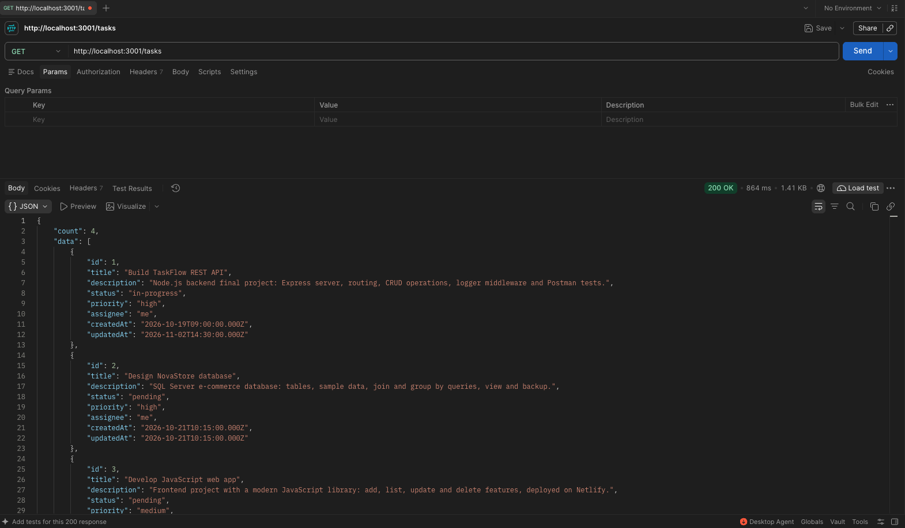
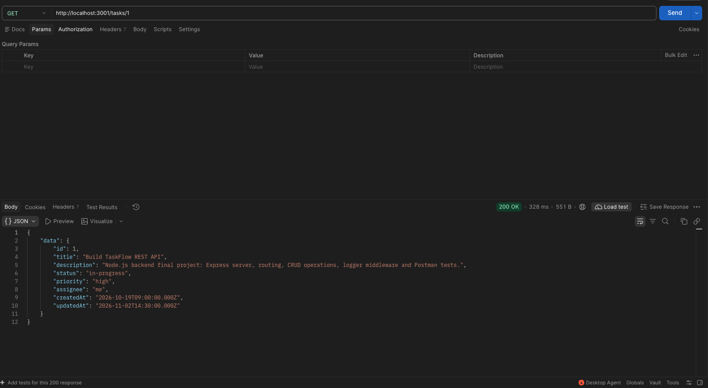
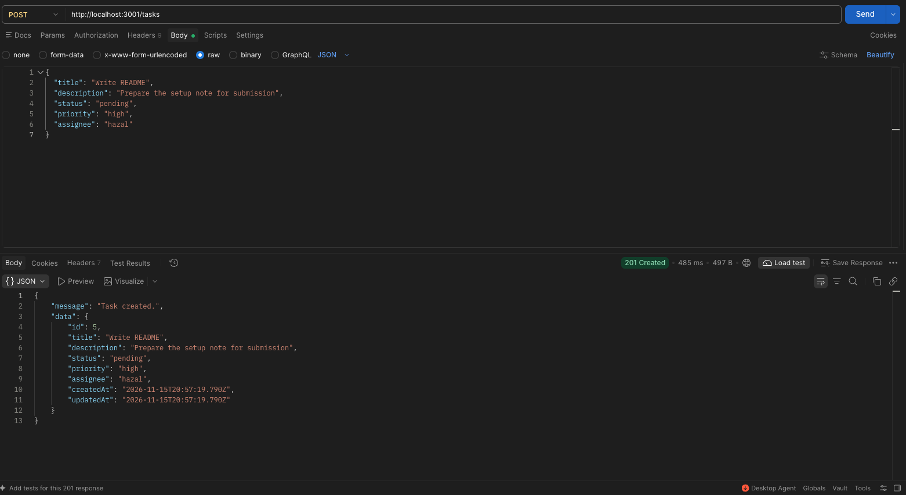
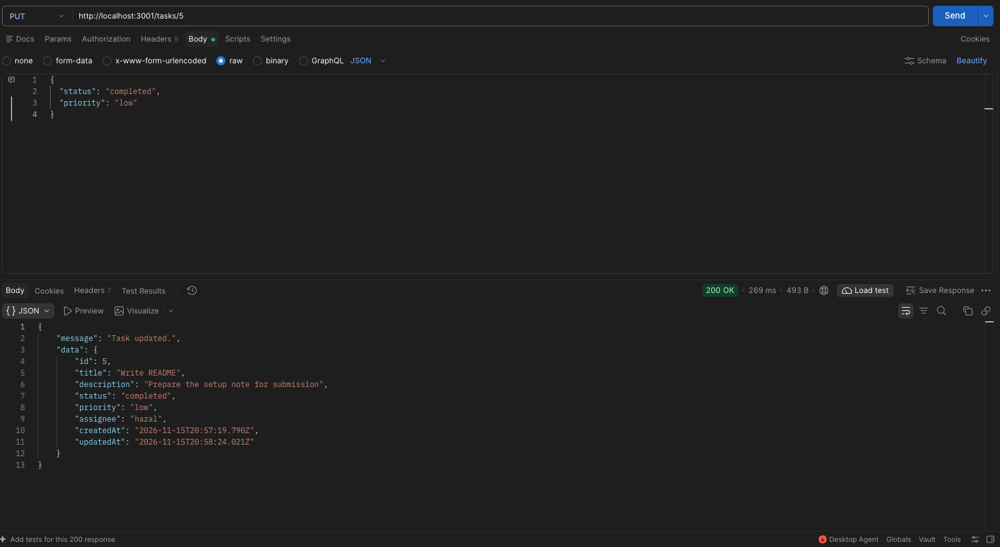
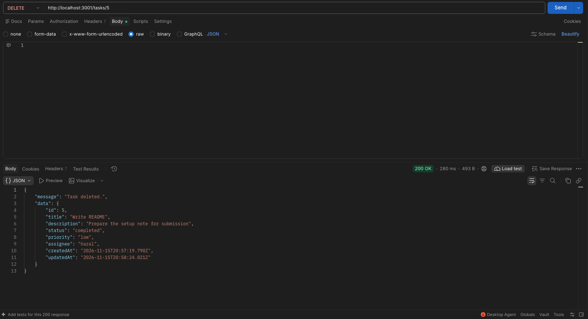
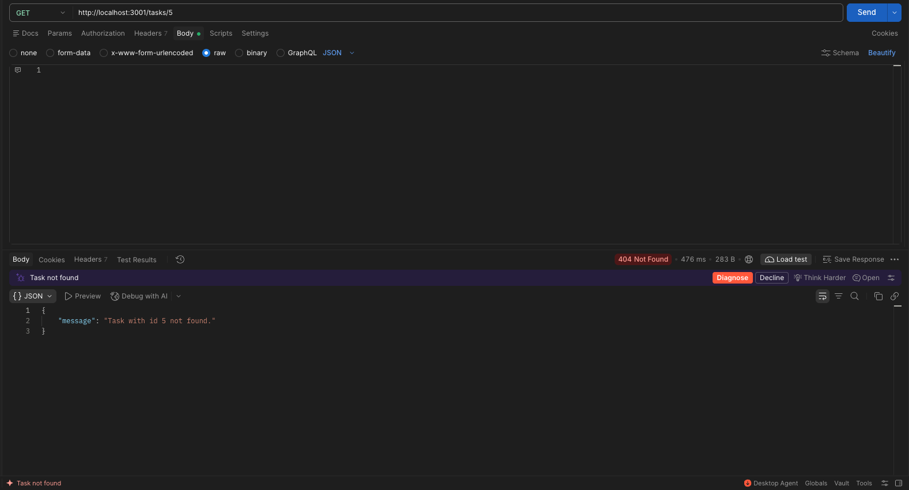

# TaskFlow

[Türkçe README](README.tr.md)

A task and project management REST API built with **Node.js** and **Express.js**.
This is the final project of the Node.js Backend Programming course.

The API lets you create, list, view, update and delete tasks. Every incoming request is recorded by a logger middleware (method, endpoint and timestamp).

## Features

- REST API with full CRUD operations for tasks
- Routing structure separated into routes and controllers
- Logger middleware (writes to the console and to `logs/requests.log`)
- Basic input checks (required title, allowed `status` and `priority` values)
- JSON file storage (`src/data/tasks.json`), so no database setup is needed

## Tech Stack

- Node.js
- Express.js 5

## Requirements

- [Node.js](https://nodejs.org/) 18 or newer
- npm (comes with Node.js)
- [Postman](https://www.postman.com/) (for testing)

## Installation

```bash
# 1. Clone the repository
git clone https://github.com/hazalbuber/taskflow.git
cd taskflow

# 2. Install dependencies
npm install

# 3. Start the server
npm start
```

The server runs at **http://localhost:3001** by default.
To use another port, set the `PORT` environment variable, for example:

```bash
# macOS / Linux
PORT=4000 npm start

# Windows (PowerShell)
$env:PORT=4000; npm start
```

When the server starts, you should see this in the terminal:

```
TaskFlow API is running at http://localhost:3001
```

## Project Structure

```
taskflow/
├── src/
│   ├── controllers/
│   │   └── taskController.js   # CRUD logic for tasks
│   ├── data/
│   │   ├── taskStore.js        # Reads and writes tasks.json
│   │   └── tasks.json          # Task data (sample data included)
│   ├── middleware/
│   │   └── logger.js           # Request logger
│   ├── routes/
│   │   └── taskRoutes.js       # /tasks routes
│   ├── app.js                  # Express app setup
│   └── server.js               # Server entry point
├── logs/
│   └── requests.log            # Created automatically on first request
├── screenshots/
│   └── ...                     # Postman test screenshots
├── package.json
└── README.md
```

## Task Model

| Field         | Type   | Description                                        | Default   |
| ------------- | ------ | -------------------------------------------------- | --------- |
| `id`          | number | Unique id, generated automatically                 | auto      |
| `title`       | string | Task title (**required**)                          | -         |
| `description` | string | Task details                                       | `""`      |
| `status`      | string | `pending`, `in-progress` or `completed`            | `pending` |
| `priority`    | string | `low`, `medium` or `high`                          | `medium`  |
| `assignee`    | string | Person responsible for the task                    | `null`    |
| `createdAt`   | string | Creation time (ISO 8601), generated automatically  | auto      |
| `updatedAt`   | string | Last update time (ISO 8601), updated automatically | auto      |

## API Endpoints

| Method | Endpoint     | Description             | Success Status |
| ------ | ------------ | ----------------------- | -------------- |
| GET    | `/`          | API overview            | 200            |
| GET    | `/tasks`     | List all tasks          | 200            |
| GET    | `/tasks/:id` | Get a single task       | 200            |
| POST   | `/tasks`     | Create a new task       | 201            |
| PUT    | `/tasks/:id` | Update an existing task | 200            |
| DELETE | `/tasks/:id` | Delete a task           | 200            |

### GET /tasks

Response `200 OK`:

```json
{
  "count": 4,
  "data": [
    {
      "id": 1,
      "title": "Build TaskFlow REST API",
      "description": "Node.js backend final project: ...",
      "status": "in-progress",
      "priority": "high",
      "assignee": "me",
      "createdAt": "2026-10-19T09:00:00.000Z",
      "updatedAt": "2026-11-02T14:30:00.000Z"
    }
  ]
}
```

### GET /tasks/:id

Response `200 OK`:

```json
{
  "data": {
    "id": 1,
    "title": "Build TaskFlow REST API",
    "status": "in-progress",
    "priority": "high",
    "assignee": "me"
  }
}
```

Response `404 Not Found` (task does not exist):

```json
{ "message": "Task with id 99 not found." }
```

### POST /tasks

Only `title` is required. Other fields fall back to their defaults.

Request body:

```json
{
  "title": "Write README",
  "description": "Prepare the setup note for submission",
  "status": "pending",
  "priority": "high",
  "assignee": "hazal"
}
```

Response `201 Created`:

```json
{
  "message": "Task created.",
  "data": {
    "id": 5,
    "title": "Write README",
    "description": "Prepare the setup note for submission",
    "status": "pending",
    "priority": "high",
    "assignee": "hazal",
    "createdAt": "2026-11-15T18:00:00.000Z",
    "updatedAt": "2026-11-15T18:00:00.000Z"
  }
}
```

Response `400 Bad Request` (for example, missing title):

```json
{ "message": "title is required." }
```

### PUT /tasks/:id

Send only the fields you want to change. The other fields keep their current values.

Request body:

```json
{
  "status": "completed",
  "priority": "low"
}
```

Response `200 OK`:

```json
{
  "message": "Task updated.",
  "data": {
    "id": 5,
    "title": "Write README",
    "status": "completed",
    "priority": "low",
    "updatedAt": "2026-11-15T18:10:00.000Z"
  }
}
```

Possible errors: `400` (invalid `title`, `status` or `priority`) and `404` (task not found).

### DELETE /tasks/:id

Response `200 OK`:

```json
{
  "message": "Task deleted.",
  "data": { "id": 5, "title": "Write README" }
}
```

Response `404 Not Found` if the task does not exist.

### Error Responses

| Status | When                                                    |
| ------ | ------------------------------------------------------- |
| 400    | Invalid or missing field, or malformed JSON in the body |
| 404    | Task or endpoint not found                              |
| 500    | Unexpected server error                                 |

## Logger Middleware

`src/middleware/logger.js` runs for every request. It prints one line to the console and appends the same line to `logs/requests.log`:

```
[2026-11-15T18:00:12.345Z] POST /tasks
[2026-11-15T18:00:20.101Z] GET /tasks/5
```

The `logs/` folder is created automatically if it does not exist, and it is listed in `.gitignore`.

## Testing with Postman

1. Start the server with `npm start`.
2. In Postman, create requests for the endpoints above using `http://localhost:3001` as the base URL.
3. For `POST` and `PUT`, choose **Body → raw → JSON** and paste the request body.
   Screenshots of these tests are in [`screenshots`](screenshots).

### Test Screenshots

**GET /tasks** (list all tasks)



**GET /tasks/1** (get a single task)



**POST /tasks** (create a task)



**PUT /tasks/5** (update a task)



**DELETE /tasks/5** (delete a task)



**GET /tasks/5** (deleted task returns 404)


