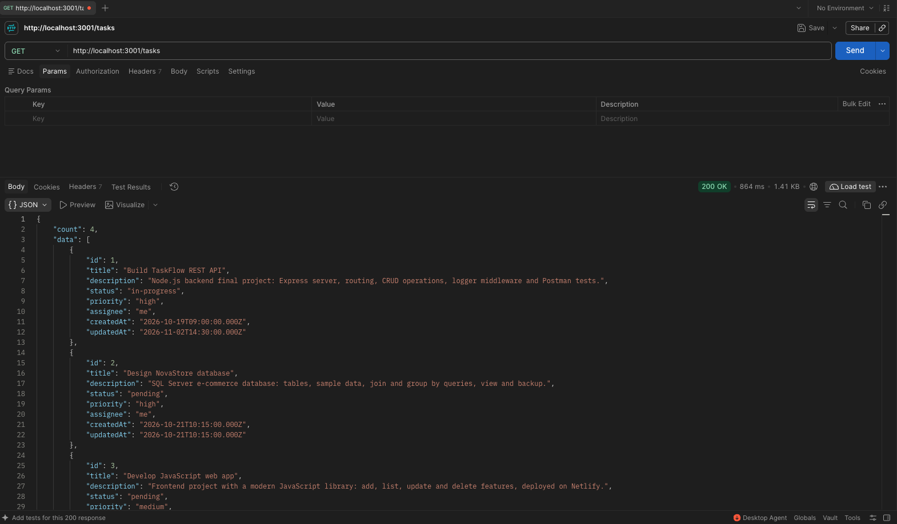
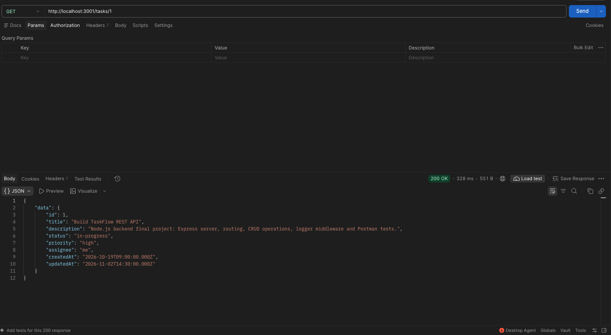
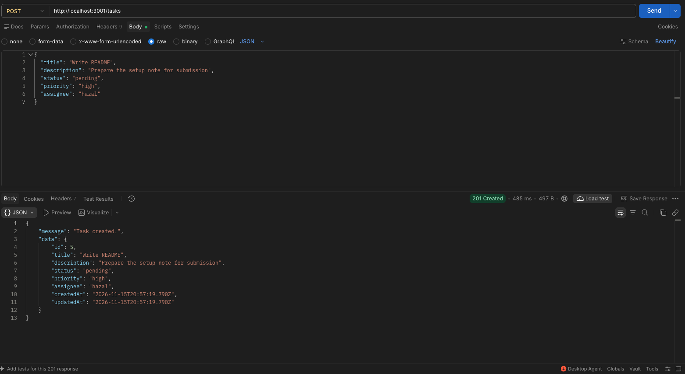
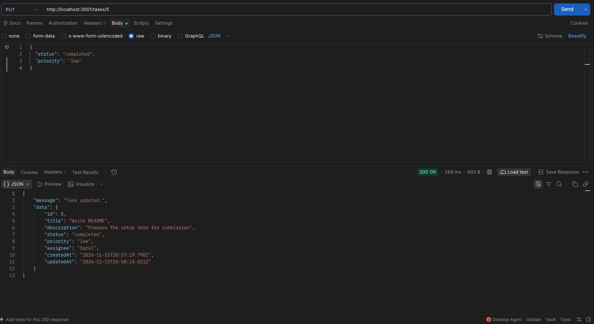
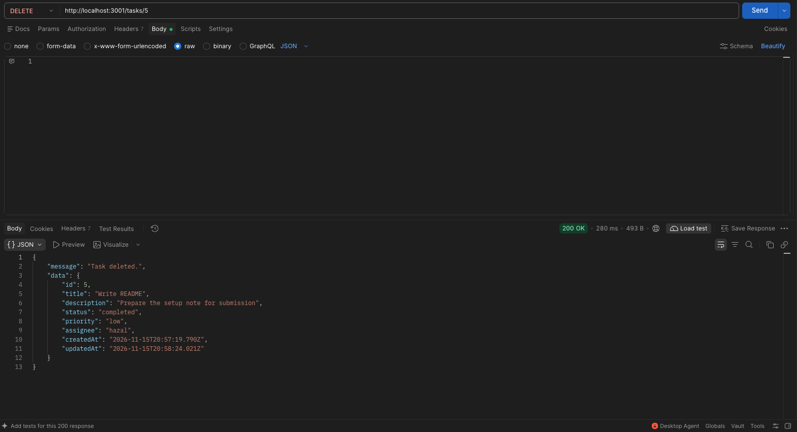
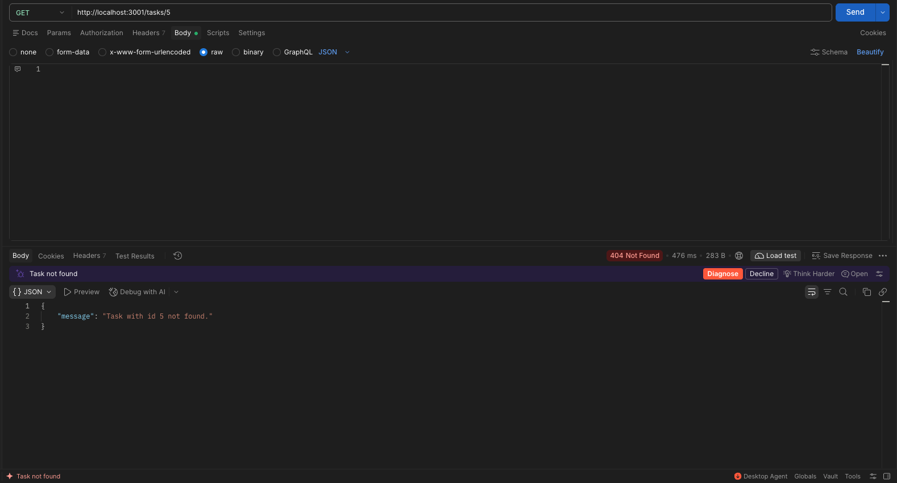

# TaskFlow

[English version](README.md)

**Node.js** ve **Express.js** ile geliştirilmiş görev ve proje yönetim sistemi REST API'si.
Bu proje, Node.js ile Backend Programlama eğitiminin bitirme projesidir.

API ile görev oluşturabilir, listeleyebilir, detayını görüntüleyebilir, güncelleyebilir ve silebilirsiniz. Gelen her istek, bir logger middleware tarafından kaydedilir (metot, adres ve zaman damgası).

## Özellikler

- Görevler için tam CRUD operasyonlarına sahip REST API
- Routes ve controllers olarak ayrılmış routing yapısı
- Logger middleware (konsola ve `logs/requests.log` dosyasına yazar)
- Temel girdi kontrolleri (zorunlu başlık, izin verilen `status` ve `priority` değerleri)
- JSON dosyasında veri saklama (`src/data/tasks.json`), veritabanı kurulumu gerekmez

## Teknolojiler

- Node.js
- Express.js 5

## Gereksinimler

- [Node.js](https://nodejs.org/) 18 veya üzeri
- npm (Node.js ile birlikte gelir)
- [Postman](https://www.postman.com/) (test için)

## Kurulum

```bash
# 1. Repoyu klonlayın
git clone https://github.com/hazalbuber/taskflow.git
cd taskflow

# 2. Bağımlılıkları kurun
npm install

# 3. Sunucuyu başlatın
npm start
```

Sunucu varsayılan olarak **http://localhost:3001** adresinde çalışır.
Farklı bir port kullanmak için `PORT` ortam değişkenini ayarlayın:

```bash
# macOS / Linux
PORT=4000 npm start

# Windows (PowerShell)
$env:PORT=4000; npm start
```

Sunucu başladığında terminalde şu satırı görmelisiniz:

```
TaskFlow API is running at http://localhost:3001
```

## Klasör Yapısı

```
taskflow/
├── src/
│   ├── controllers/
│   │   └── taskController.js   # Görevlerin CRUD mantığı
│   ├── data/
│   │   ├── taskStore.js        # tasks.json dosyasını okur ve yazar
│   │   └── tasks.json          # Görev verileri (örnek veriler dahil)
│   ├── middleware/
│   │   └── logger.js           # İstek kaydı (logger)
│   ├── routes/
│   │   └── taskRoutes.js       # /tasks yolları
│   ├── app.js                  # Express uygulama kurulumu
│   └── server.js               # Sunucu giriş noktası
├── logs/
│   └── requests.log            # İlk istekte otomatik oluşturulur
├── screenshots/
│   └── ...                     # Postman test ekran görüntüleri
├── package.json
└── README.md
```

## Görev Modeli

| Alan          | Tür    | Açıklama                                                  | Varsayılan |
| ------------- | ------ | --------------------------------------------------------- | ---------- |
| `id`          | sayı   | Benzersiz kimlik, otomatik üretilir                       | otomatik   |
| `title`       | metin  | Görev başlığı (**zorunlu**)                               | -          |
| `description` | metin  | Görev açıklaması                                          | `""`       |
| `status`      | metin  | `pending`, `in-progress` veya `completed`                 | `pending`  |
| `priority`    | metin  | `low`, `medium` veya `high`                               | `medium`   |
| `assignee`    | metin  | Görevden sorumlu kişi                                     | `null`     |
| `createdAt`   | metin  | Oluşturma zamanı (ISO 8601), otomatik üretilir            | otomatik   |
| `updatedAt`   | metin  | Son güncelleme zamanı (ISO 8601), otomatik güncellenir    | otomatik   |

## API Uç Noktaları

| Metot  | Uç Nokta     | Açıklama                    | Başarılı Durum |
| ------ | ------------ | --------------------------- | -------------- |
| GET    | `/`          | API genel bakışı            | 200            |
| GET    | `/tasks`     | Tüm görevleri listeler      | 200            |
| GET    | `/tasks/:id` | Tek bir görevi getirir      | 200            |
| POST   | `/tasks`     | Yeni görev oluşturur        | 201            |
| PUT    | `/tasks/:id` | Var olan görevi günceller   | 200            |
| DELETE | `/tasks/:id` | Görevi siler                | 200            |

### GET /tasks

Cevap `200 OK`:

```json
{
  "count": 4,
  "data": [
    {
      "id": 1,
      "title": "Build TaskFlow REST API",
      "description": "Node.js backend final project: ...",
      "status": "in-progress",
      "priority": "high",
      "assignee": "me",
      "createdAt": "2026-10-19T09:00:00.000Z",
      "updatedAt": "2026-11-02T14:30:00.000Z"
    }
  ]
}
```

### GET /tasks/:id

Cevap `200 OK`:

```json
{
  "data": {
    "id": 1,
    "title": "Build TaskFlow REST API",
    "status": "in-progress",
    "priority": "high",
    "assignee": "me"
  }
}
```

Cevap `404 Not Found` (görev yoksa):

```json
{ "message": "Task with id 99 not found." }
```

### POST /tasks

Yalnızca `title` zorunludur. Diğer alanlar verilmezse varsayılan değerleri alır.

İstek gövdesi:

```json
{
  "title": "Write README",
  "description": "Prepare the setup note for submission",
  "status": "pending",
  "priority": "high",
  "assignee": "hazal"
}
```

Cevap `201 Created`:

```json
{
  "message": "Task created.",
  "data": {
    "id": 5,
    "title": "Write README",
    "description": "Prepare the setup note for submission",
    "status": "pending",
    "priority": "high",
    "assignee": "hazal",
    "createdAt": "2026-11-15T18:00:00.000Z",
    "updatedAt": "2026-11-15T18:00:00.000Z"
  }
}
```

Cevap `400 Bad Request` (örneğin başlık eksikse):

```json
{ "message": "title is required." }
```

### PUT /tasks/:id

Yalnızca değiştirmek istediğiniz alanları gönderin. Diğer alanlar mevcut değerlerini korur.

İstek gövdesi:

```json
{
  "status": "completed",
  "priority": "low"
}
```

Cevap `200 OK`:

```json
{
  "message": "Task updated.",
  "data": {
    "id": 5,
    "title": "Write README",
    "status": "completed",
    "priority": "low",
    "updatedAt": "2026-11-15T18:10:00.000Z"
  }
}
```

Olası hatalar: `400` (geçersiz `title`, `status` veya `priority`) ve `404` (görev bulunamadı).

### DELETE /tasks/:id

Cevap `200 OK`:

```json
{
  "message": "Task deleted.",
  "data": { "id": 5, "title": "Write README" }
}
```

Görev yoksa cevap `404 Not Found` olur.

### Hata Cevapları

| Durum | Ne zaman                                                       |
| ----- | -------------------------------------------------------------- |
| 400   | Geçersiz veya eksik alan, ya da gövdede hatalı JSON            |
| 404   | Görev veya uç nokta bulunamadı                                 |
| 500   | Beklenmeyen sunucu hatası                                      |

## Logger Middleware

`src/middleware/logger.js` her istekte çalışır. Konsola bir satır yazar ve aynı satırı `logs/requests.log` dosyasına ekler:

```
[2026-11-15T18:00:12.345Z] POST /tasks
[2026-11-15T18:00:20.101Z] GET /tasks/5
```

`logs/` klasörü yoksa otomatik oluşturulur ve `.gitignore` dosyasında listelidir.

## Postman ile Test

1. Sunucuyu `npm start` ile başlatın.
2. Postman'de yukarıdaki uç noktalar için istekler oluşturun, temel adres olarak `http://localhost:3001` kullanın.
3. `POST` ve `PUT` için **Body → raw → JSON** seçin ve istek gövdesini yapıştırın.

Bu testlerin ekran görüntüleri [`screenshots`](screenshots) klasöründedir.

### Test Ekran Görüntüleri

**GET /tasks** (tüm görevleri listele)



**GET /tasks/1** (tek görevi getir)



**POST /tasks** (görev oluştur)



**PUT /tasks/5** (görevi güncelle)



**DELETE /tasks/5** (görevi sil)



**GET /tasks/5** (silinen görev 404 döner)


